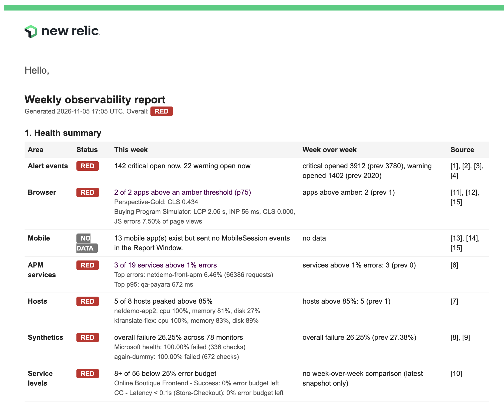

# Weekly Observability Report: quick start

A New Relic Workflow Automation workflow that emails a weekly health report for one account. It covers which areas are red, amber or green, the critical alert events that are still open, Autopilot's probable causes and recommended actions, and any data gaps. Setup takes about 15 minutes.

## Front page of sample report



This sample comes from a New Relic demo account. The whole email, including Autopilot's analysis and the NRQL sources, is in [docs/sample-report.pdf](docs/sample-report.pdf) (4 pages; the recipient and account ID are redacted).

## Files

| File | What it is |
|---|---|
| `README.md` | This guide |
| `weekly-report.yaml` | The workflow definition, ready to deploy. It works in any account. |
| `weekly_report.py` | A command-line helper to deploy, run, and schedule the workflow. It needs Python 3.10+ and nothing else (standard library only). |
| `docs/` | The sample screenshot and PDF shown above |

## What the email contains

1. **Health summary.** One row per Health Area: Alert events, Browser, Mobile, APM services, Hosts, Synthetics, and Service levels. Each row shows its status, this week's numbers, and the change from last week. Browser and Mobile appear only if the account has browser or mobile apps.
2. **Critical alert events.** How many are open now and how many opened this week, plus the longest-open ones.
3. **Probable causes and recommended actions.** Written by Autopilot for the top 3 open critical alert events, with the evidence it found.
4. **Data gaps.** Any area whose data source sent nothing this week. NO DATA is never shown as green.
5. **Sources.** The NRQL behind every number.

Each run also writes one `WeeklyObservabilityReport` event, so you can chart the history week by week:

```sql
SELECT * FROM WeeklyObservabilityReport SINCE 3 months ago
```

The statuses come from fixed rules, so the same data always gives the same colours.

| Area | Red | Amber |
|---|---|---|
| Alert events | A critical alert event is still open | A critical one opened this week, or a warning one is open |
| Browser | An app's p75 LCP is above 4 s, INP above 500 ms or CLS above 0.25, or it had more than 25 JavaScript errors per 100 page views | An app's p75 LCP is above 2.5 s, INP above 200 ms or CLS above 0.1, or it had more than 5 JavaScript errors per 100 page views |
| Mobile | An app crashed in more than 3% of sessions, or more than 20% of its HTTP requests failed | An app crashed in more than 1% of sessions, or more than 5% of its HTTP requests failed |
| APM services | A service is above 5% errors | A service is above 1% errors, or its p95 is more than 20% slower than last week |
| Hosts | A host peaked above 95% CPU, memory or disk | A host peaked above 85% |
| Synthetics | A monitor failed more than 50% of its checks | A monitor failed more than 5% |
| Service levels | A service level has 0% error budget left | A service level has less than 25% left |

The Browser thresholds are Google's Core Web Vitals cut-offs. APM services count only if they had at least 100 requests. A browser metric counts only if the app had at least 20 samples of it, and a mobile app counts only if it had at least 50 sessions. If the account has browser or mobile apps but they sent no data this week, the area shows NO DATA and appears under data gaps. If the account has no such apps, the area is left out. "Alert events" are the open-to-close records in `NrAiIncident`, which the New Relic alerts UI calls incidents.

## How the workflow works

```
14 queries → app lookup → 4 scoring scripts → Autopilot → build email → format Autopilot text → send email → save history → save run summary
```

The workflow has 24 steps, which run in order inside New Relic. No server of your own is needed.

**1. Collect the numbers (14 `newrelic.nrdb.query` steps, named `q_…`).** Each step runs one NRQL query over the last 7 days and the 7 days before. A jq selector keeps only the rows needed.

| Step | Question it answers |
|---|---|
| `q_inc_crit`, `q_inc_warn` | How many critical and warning alert events are open right now? |
| `q_inc_opened` | How many opened this week, compared with last week? |
| `q_inc_open_rows` | Which critical alert events are open, since when, and on which entity? |
| `q_counts` | Does each data source have any data at all? (This is how data gaps are found.) |
| `q_apm` | Which services have high error rates, or got slower? |
| `q_hosts` | Which hosts peaked on CPU, memory or disk? |
| `q_synth_overall`, `q_synth_monitors` | What share of Synthetics checks failed, and which monitors were worst? |
| `q_sls` | Which service levels are low on error budget? |
| `q_br`, `q_js` | Which browser apps have slow Core Web Vitals (LCP, INP, CLS at p75), or many JavaScript errors per page view? |
| `q_mob`, `q_mob_ver` | Which mobile apps crash most, or have failing HTTP requests, and which app version crashed most? |

The `apps` step (`newrelic.nerdgraph.execute`) counts the account's browser and mobile apps. That is how the workflow tells "no apps" (area left out) from "apps that sent no data" (a data gap).

**2. Score each area (4 `script.run` Python steps).** These apply the rules in the table above. No AI is involved.
- `sa`: Alert events, including the 3 longest-open critical ones.
- `sb`: APM services.
- `sc`: Hosts, Synthetics, and Service levels.
- `sd`: Browser and Mobile.

**3. Ask Autopilot why (`ask`, `newrelic.autopilot.run`).**
- The step sends one prompt containing the health summary and the 3 alert events.
- It asks for probable causes and recommended actions. Autopilot can run its own NRQL for evidence and is told to write "unknown" rather than guess.
- Autopilot never sets the numbers or the colours.

**4. Build the email (`r1`).**
- This step builds the header, the coloured health summary table, the critical alert events list, the data gaps, the subject line (for example `[RED] Weekly observability report, 2026-11-04`), and the history event.
- It also checks whether Autopilot's reply really is an analysis. If not, section 3 says "Autopilot gave no analysis because …" and gives the reason.

**5. Format Autopilot's text (`md`).** Turns Autopilot's markdown (headings, bold, lists, tables) into email HTML. Very long replies are cut to fit, with a note saying so.

**6. Send and record.**
- `email` (`newrelic.notification.sendEmail`) sends the email to your email destination.
- `record` (`newrelic.ingest.sendEvents`) writes the `WeeklyObservabilityReport` event.
- `save` stores a short run summary: whether Autopilot gave an analysis, and whether the email and the event were sent.

## Before you start

- **Workflow Automation** in your account. This needs the Advanced Compute plan.
- **Autopilot** in your account, for section 3. Each run uses Autopilot capacity (aCCU) and takes about 1 to 3 minutes.
- **A User API key** (`NRAK-…`) that can query data and create and run workflows. Create it under API keys in New Relic.
- **An email destination** for the report, under Alerts > Destinations. If you don't have one, create it first.

## Set up with the script (recommended)

**1. Get the files,** by cloning this repository (or putting the three files in one folder). Then create `~/.nr-weekly.env`:

```
NR_API_KEY=NRAK-...
NR_ACCOUNT_ID=1234567
NR_REGION=us
```

Set `NR_REGION=eu` if your account is in the EU region.

**2. Find your email destination ID.**

```
python weekly_report.py --destinations
```

Copy the ID of the destination that should receive the report, and add it to `~/.nr-weekly.env`:

```
DESTINATION_ID=00000000-0000-0000-0000-000000000000
```

**3. Check the workflow against your account.** This changes nothing.

```
python weekly_report.py --check
```

Expected output: `YAML valid.`

**4. Deploy the workflow.** This creates `weekly-observability-report` in your account, or updates it if it already exists.

```
python weekly_report.py --deploy
```

**5. Run it once.** This calls Autopilot and sends the email.

```
python weekly_report.py --run --confirm-send
```

After about 1 to 3 minutes it prints the run summary. A good run looks like this:

```
status COMPLETED
  ask_success: true
  ask_analysed: true
  email_success: true
  record_success: true
  summary: "Alert events RED; APM services AMBER; Hosts GREEN; Synthetics RED; Service levels NO DATA"
```

Check the email. Then confirm the history event arrived:

```sql
SELECT * FROM WeeklyObservabilityReport SINCE 1 hour ago
```

**6. Schedule it (optional).** First see what would be created, then create it:

```
python weekly_report.py --schedule
python weekly_report.py --schedule --confirm-schedule
```

The default is every Monday at 08:00 `Europe/Dublin`. From then on, it emails and uses Autopilot capacity every week until you run `python weekly_report.py --unschedule`.

## Set up without Python

1. Open `weekly-report.yaml`. Replace `REPLACE_WITH_EMAIL_DESTINATION_ID` with your email destination ID. You'll find it under Alerts > Destinations.
2. In New Relic, open Workflow Automation and create a workflow from the YAML. The exact menu labels may differ in your account.
3. Run it from the UI. Each step's result appears in the run view.

## Change things

| To change | Do this |
|---|---|
| **The schedule time** | `python weekly_report.py --schedule --cron "30 7 * * 2" --timezone Europe/London --confirm-schedule`. To make it the default, set `NR_REPORT_CRON` and `NR_REPORT_TIMEZONE` in `~/.nr-weekly.env`. The command creates the new schedule, then deletes the old one, because New Relic's API cannot edit a schedule in place. |
| **The thresholds** | Edit the `defaultValue` of the inputs at the top of `weekly-report.yaml` (for example `errRedPct`, `hostAmberPct`, `synthRedPct`, `lcpRedSec`, `crashAmberPct`), then run `--deploy` again. |
| **Who gets the email** | Use a different `DESTINATION_ID` (a team mailbox works well), then run `--deploy` again. |
| **After any redeploy** | If a schedule exists, run `--schedule --confirm-schedule` again. A schedule is pinned to one workflow version, so it keeps running the old version until you do. |

## Check a run and troubleshoot

To see what every step received and returned, run with `--log-level TRACE`, then query the logs. The run ID is printed by `--run`:

```sql
FROM Log SELECT * WHERE workflowAutomation.runId = '<run id>' SINCE 1 hour ago
```

At the default `INFO` level the logs only show each step starting and finishing. At `TRACE`, each step's "has completed" line also carries its outputs. For example, `workflowAutomation.outputs.answer` holds Autopilot's reply, cut at 4,094 characters.

| You see | Meaning | What to do |
|---|---|---|
| `ask_analysed: false` and "Autopilot gave no analysis because …" | Autopilot ran but gave no usable analysis. The email gives the reason. | Read the reason. If the step failed with `ADVANCED_DAILY_SI_LIMIT_EXCEEDED`, the account's daily Autopilot capacity is used up, so try again tomorrow. |
| An area shows NO DATA | That source sent no events this week, for example no Synthetics monitors. | Expected if you don't use that product. Otherwise check the integration. |
| `email_success: false` | Usually a wrong or inactive destination ID. | Run `--destinations`, fix `DESTINATION_ID`, then `--deploy`. |
| `Set DESTINATION_ID …` or `Set NR_API_KEY …` | Missing config. | Add it to `~/.nr-weekly.env`. |
| The run fails before any step | The workflow isn't deployed, or the key can't use Workflow Automation. | Run `--check`, then `--deploy`. Check that the key is a User key for this account. |

## Limits to know

- **Old alert events are missed.** Critical alert events that opened more than 7 days ago and are still open are not counted, so "open now" can undercount.
- **Rankings use the top rows only:** 12 services by error rate, 5 by p95, 15 hosts by peak, 10 monitors, 8 service levels, 6 browser apps by Core Web Vitals samples, 6 by page views, and 6 mobile apps by sessions. Counts such as "hosts above 85%" are therefore capped at those numbers.
- **Mobile HTTP errors need `MobileRequest` events.** If an app sends errors but no `MobileRequest` events, the email shows the error count instead of a rate.
- **Autopilot's text varies.** It doesn't always follow the requested format, and it can be wrong. Treat its causes as leads to check, not conclusions.
- **Charts are dropped.** Autopilot sometimes includes charts, which the email leaves out.
- **Run cost.** Every run, scheduled or manual, sends an email and uses Autopilot capacity.

## Remove it

```
python weekly_report.py --unschedule
python weekly_report.py --delete
```

`WeeklyObservabilityReport` events already written stay in the account until their data retention ends.
